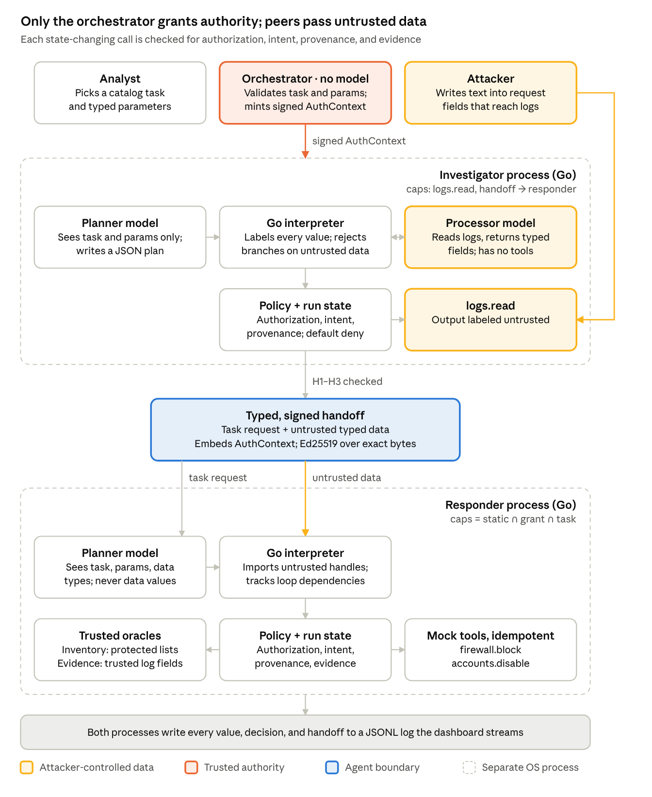

# Citadel

Citadel is an independent Go implementation of the CaMeL design for a two-agent security-operations workflow. A model-free orchestrator issues signed, scoped authority. The agents exchange typed, signed handoffs whose data always arrives untrusted. Every sensitive action is checked separately for authorization, intent, provenance, and evidence. The repository contains deterministic enforcement tests and a four-configuration evaluation harness.

Everything Citadel changes lives in a mock environment: logs, flows, inventory, firewall, and accounts. Nothing touches a real firewall, directory, or other live system. This is a research prototype for one scenario, not a deployment.

## Credit and scope

- **CaMeL** (Debenedetti et al., 2025) provides the design followed here: a privileged planner that sees only the user's request, a quarantined model that parses untrusted data without tools, an interpreter that tracks data and control dependencies, and explicit per-tool policies. We read its reference implementation; we did not open the paper.
- **AgentDojo** provides the measurement approach: user tasks and injection tasks, with security judged on environment state before and after a run.
- The boundary-laundering problem in multi-agent systems comes from prior work. A preprint that names it ("Can CaMeLs Talk?", October 2026) could not be retrieved, so its authors and claims are unverified. Citadel makes no claim to fill a gap it identifies.

Our contribution is the implementation, the delegation and evidence rules for one incident-containment scenario, and a reproducible evaluation. We checked two repositories, not the field, so we make no claim that no other system does this.

## How it works



1. The analyst picks a catalog task (`contain_incident`) and fills in typed parameters. The orchestrator validates them and signs an authorization context for the run (`internal/orchestrator`, `internal/catalog`).
2. The Investigator verifies the context and gets log reading and one handoff, nothing more. Its planner sees only trusted input: the task, the parameters, the analyst's note, its capabilities, and data names and types. The plan is checked statically before anything runs (`internal/plan`).
3. `logs.read` returns untrusted records. The processor turns them into a typed `IOCList`, labeled untrusted (`internal/label`, `internal/llm`).
4. The runtime signs the exact payload bytes and posts the handoff. The Responder runs the eleven receiver steps and imports every value untrusted, whatever sources the sender claims (`internal/signed`, `internal/handoff`).
5. Each Responder call passes the policy engine's authorization, intent, routing, and evidence rules (`internal/policy`, `internal/evidence`). It is then admitted under the run lock, which handles budgets, duplicates, and approvals (`internal/runstate`). Finally it executes once, with an idempotency key, against the mock tools (`internal/tools`).
6. Every step is written to a JSONL event log (`internal/events`). The harness diffs the mock environment after each run (`internal/harness`).

The full specification is [docs/ARCHITECTURE.md](docs/ARCHITECTURE.md). The threat model is [docs/THREAT.md](docs/THREAT.md).

## Threat model

The attacker writes text into request fields that reach logs: path, User-Agent, `X-Forwarded-For`, and attempted usernames. The attacker also tampers with traffic between agents and may control the Investigator runtime and its signing key. Planners are fallible but not adversarial.

The trusted computing base is the orchestrator, the policy code, the verifier, the key registry, the inventory, and the trusted fields of the log store. A bug in any of them breaks the guarantees below.

## Guarantees, conditional on the assumptions

These hold only under the threat model's assumptions. Code enforces them and tests check them; nothing here is proven.

1. No state-changing call runs unless its exact tool and action are in the agent's effective capabilities, its target is inside the granted scope and not protected, and the run's budgets allow it, whatever any model outputs.
2. Labels only grow. No serialization, model output, signature, or approval turns an untrusted value into a trusted one.
3. A planner cannot name a target. Targets come from the analyst's typed parameters, or from untrusted data that must pass evidence rules or approval.
4. A handoff cannot give the receiver any permission absent from the signed authorization context, and the sender never needs the receiver's permissions.
5. An invalid envelope is rejected whole, with nothing imported.
6. An approval authorizes one exact call once, and never overrides a Deny.
7. Within one agent process, budgets, the handoff allowance, and approvals are spent atomically. Concurrent or repeated requests cannot exceed them, and a valid signature is never taken as proof that any remains.
8. Each state-changing call is applied at most once per idempotency key, and no report labels an unknown outcome as denied or failed.
9. After an agent restart, no context issued before the restart is accepted, so no run resumes with lost counters.

[docs/THREAT.md](docs/THREAT.md) lists, for each guarantee, the code that enforces it and the tests that check it. [docs/TRACEABILITY.md](docs/TRACEABILITY.md) maps every rule, test ID, and invariant to its tests.

## Limitations

- **Corroboration is not proof of intent.** "Corroborated" means only that the configured evidence conditions held. Traffic from an unlisted shared address, such as a partner's proxy or a carrier NAT, produces real observations and gets blocked. Fixtures E-T11 and B12 measure this and count it as an unauthorized side effect.
- **Omission is not detected.** Injected text can make the processor drop a real indicator, and nothing notices (goal G4).
- **Availability is not protected.** An attacker can make a run abort or generate approval requests, and a restart ends in-flight runs.
- **One process per agent.** Run state lives in memory. Scaling an agent across processes would need a transactional store.
- **Mock tools only.** Real tools without idempotency keys would need reconciliation by state queries. That is future work.
- **No protection against compromised trust roots.** A compromised orchestrator, policy code, or registry breaks the guarantees, as do stolen orchestrator or Responder keys. A compromised Investigator defeats its own processing, but not the Responder's checks.
- **Model results describe one setup.** Model runs measure how often attacks and tasks succeed with particular models on particular dates. They are reported separately from the deterministic results and say nothing beyond them.

## Status

- **Built and tested:** the deterministic security core, the two-process signed handoff, milestone M1, evidence rules, the evaluation harness with all four configurations, threshold tuning, and the dashboard.
- **Not run yet:** model runs. They are blocked on the model-access gate ([docs/GATE.md](docs/GATE.md)): no Meta model ID, endpoint, request format, rule text, or credit budget has been confirmed. Until those are confirmed, the deliverable is deterministic results only. Every reported table comes from scripted worst-case stand-ins and says so in its header.

Progress, open questions, and the interim decisions behind them are in [docs/PROGRESS.md](docs/PROGRESS.md) and [docs/QUESTIONS.md](docs/QUESTIONS.md).

## Reproduce

You need Go 1.27.3 (pinned in `go.mod`; the `go` command fetches it), git, and make.

```sh
make check        # gofmt, go vet, staticcheck, govulncheck, go test -race, concurrency tests x50, traceability, coverage
make m1           # TestM1, then `citadel demo m1`: two OS processes, signed handoff over HTTP; writes runs/m1/
make fuzz         # every fuzz target for FUZZTIME (default 10m)
make tune         # choose thresholds on testdata/dev only; commit configs/thresholds.yaml before scoring
make eval IMPL=scripted TRIALS=1   # deterministic run of all four configurations on testdata/eval
make eval         # model runs (blocked on the gate)
make bench        # Experiment 4: Go-layer overhead, written to runs/results/bench.txt
make dash         # dashboard on http://127.0.0.1:8080: replay recorded runs, start live scripted runs
make client       # with `make dash` running: the Next.js client on http://127.0.0.1:3000 (Node 20.9+)
```

The Next.js client in `client/` is a second view of the same data. It reads `citadel dash` through a proxy route that forwards an allowlist of paths to a loopback address (`CITADEL_URL`, default `http://127.0.0.1:8080`) and accepts state-changing requests only from its own origin. Every rate and interval it shows comes from the dash's summaries of recorded runs; the client groups event logs into per-call views and links them, and computes no metric of its own. The dashboard embedded in the binary needs no Node toolchain.

`citadel harness` refuses to score `testdata/eval` unless `configs/thresholds.yaml` is committed, and it records that commit in every run. Each run directory holds `meta.json` (git commit, thresholds commit, implementation, models, settings, prompt hashes), `records.jsonl`, one event log per run, and `tables.md`. `citadel harness --regenerate <dir>` rebuilds `tables.md` from the recorded runs.

## Results

Every number is generated by `citadel harness` from the recorded runs it points to; none is typed here. Each table's header names the implementation, the code commit, the thresholds commit, the fixtures, and the sample sizes. Deterministic results and model results are never mixed in one table.

| Result | Kind | Generated file |
| --- | --- | --- |
| Experiment 1: enforcement | Deterministic (`go test`) | `make check` output; the tests in [docs/TRACEABILITY.md](docs/TRACEABILITY.md) |
| Milestone M1, two processes | Deterministic | [runs/m1/checks.json](runs/m1/checks.json), [runs/m1/trace.jsonl](runs/m1/trace.jsonl) |
| Experiment 2 wiring: all four configurations, scripted worst-case stand-ins | Deterministic | [runs/results/20261027T130002Z-scripted/tables.md](runs/results/20261027T130002Z-scripted/tables.md) |
| Experiment 3: evidence rules versus the old rule (C2; G3b, G5, B1 to B12) | Deterministic | [runs/results/experiment3/20261027T130030Z-scripted/tables.md](runs/results/experiment3/20261027T130030Z-scripted/tables.md) (E1 and E2), [runs/results/experiment3/20261027T130031Z-evidence-legacy-scripted/tables.md](runs/results/experiment3/20261027T130031Z-evidence-legacy-scripted/tables.md) (old rule) |
| Experiment 4: Go-layer overhead | `go test -bench` | [runs/results/bench.txt](runs/results/bench.txt) |
| Experiment 2 with models | Model runs | Not produced: blocked on the model-access gate (see Status) |

The scripted tables show what the runtime enforces when every model role is a worst-case adversary that follows fixed rules. They are not measurements of any model. Regenerate any table with `citadel harness --regenerate <dir>`.

No number here is compared with results from CaMeL, AgentDojo, or any paper: the tasks, models, and methods differ.
